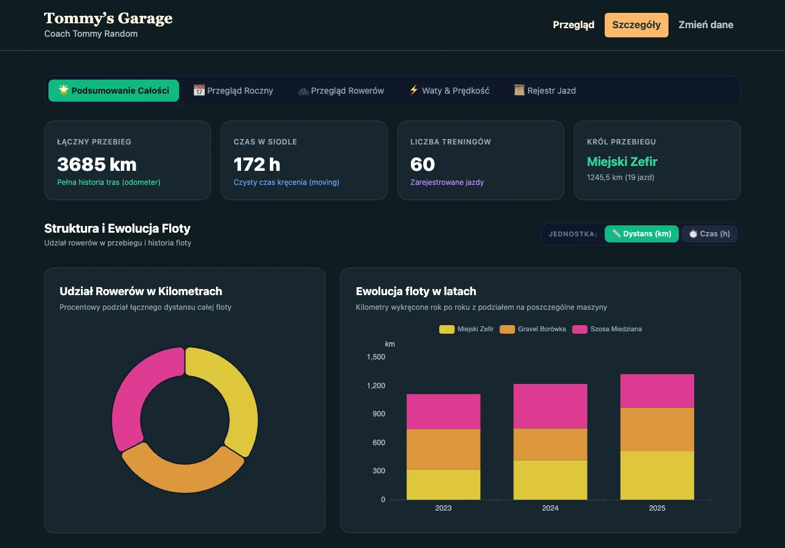

# Tommy’s Garage

Bike fleet stats by Coach Tommy Random. The Polish dashboard runs offline in your browser. [User guide](docs/USER_GUIDE.md)



## Use it

Open [Tommy’s Garage](https://michal-fularz.github.io/tommy-garage/) or download the [offline release](https://github.com/Michal-Fularz/tommy-garage/releases/latest). Choose **Wybierz plik ze Stravy** and select a Strava ZIP or `activities.csv`. **Wypróbuj demo** opens sample rides.

**Przegląd** shows distance, moving time, and rides per bike. **Szczegóły** adds charts and searchable ride history. The app also accepts [coach ride exports](RIDE_FORMAT.md).

## Build it

```sh
npm ci
npm test
npm run build
```

The build produces a single shareable `dist/index.html`. The [Dashboard workflow](.github/workflows/pages.yml) publishes it to GitHub Pages from `main`.

[MIT License](LICENSE)
